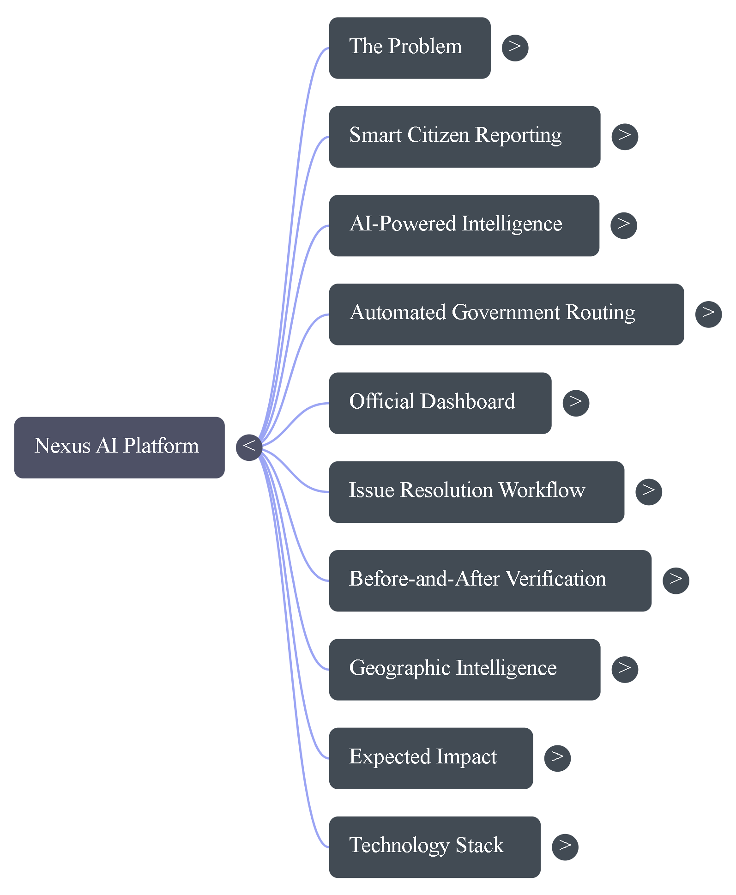
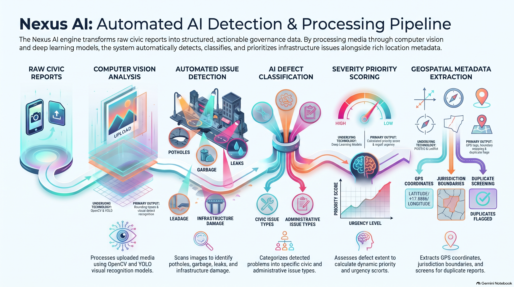
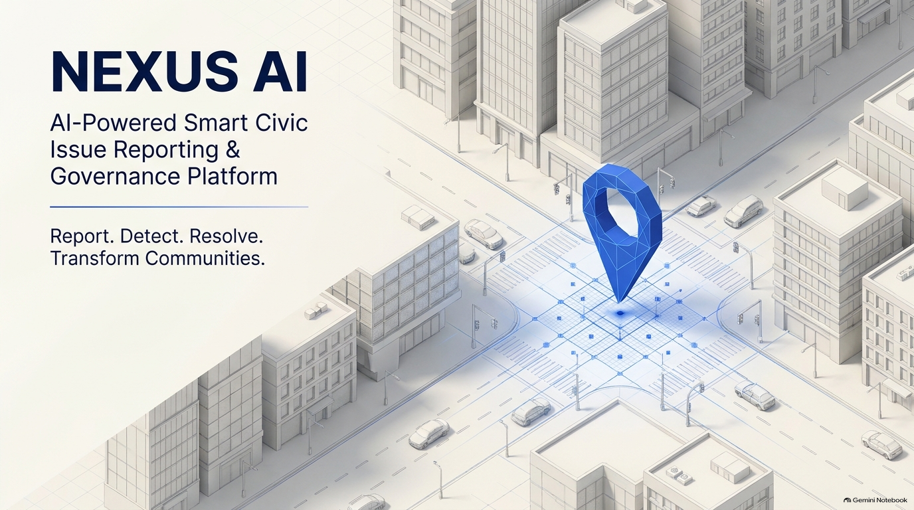
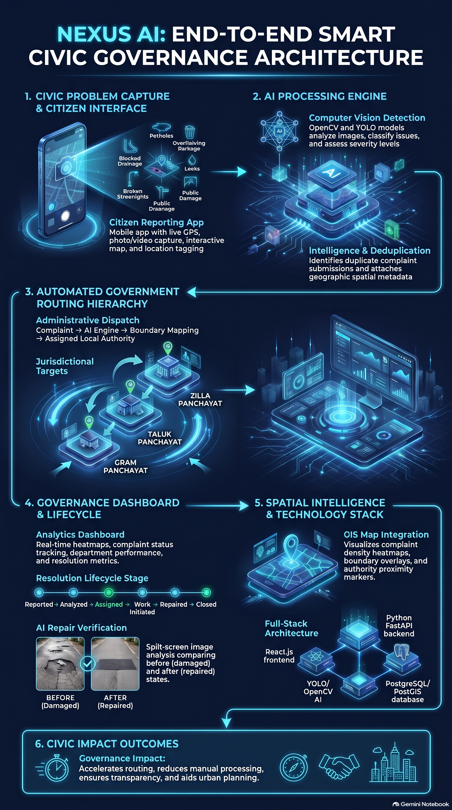

# NEXUS AI — The Living Intelligence Map

**AI-Powered Urban Infrastructure Intelligence Platform**

> Detects problems from images · Predicts severity · Finds duplicates · Recommends solutions · Maps your city's living intelligence

[](https://python.org)
[](https://fastapi.tiangolo.com)
[](https://react.dev)
[](https://ultralytics.com)
[](https://docker.com)
[](LICENSE)

<p align="center">
  
</p>

The banner is the title slide extracted from the uploaded PowerPoint. It is not a separately generated graphic.

## Contents

| | | |
|---|---|---|
| [Project Overview](#project-overview) | [Problem Statement](#problem-statement) | [Proposed Solution](#proposed-solution) |
| [Key Features](#key-features) | [Project Infographic](#project-infographic) | [Project Presentation](#project-presentation) |
| [System Architecture](#system-architecture) | [Technology Stack](#technology-stack) | [Project Workflow](#project-workflow) |
| [Future Enhancements](#future-enhancements) | [Installation and Setup](#installation-and-setup) | [Contribution](#contribution) |
| [License](#license) | [NotebookLM artifact](#project-presentation) | [Full technical write-up](#1-executive-summary) |

## Project Overview

NEXUS AI is a civic reporting platform for photographing public problems, attaching GPS when the user allows it, and keeping a NEXUS reference until a verified authority acts. The sections below keep the original technical write-up. Government portals such as Janaspandana iPGRS, Panchatantra, and Panchamitra are not connected unless an administrator records a reference from those systems.



## Problem Statement

Urban defects such as damaged roads, garbage, blocked drains, and broken streetlights are reported without consistent location, severity, or ownership. The detailed problem statement is in [section 2](#2-problem-statement).

## Proposed Solution

A citizen report stores the description, category, media, and GPS coordinates. Jurisdiction is assigned only when a verified boundary polygon contains the point. Otherwise the report stays pending verification. The product architecture is in [section 5](#5-proposed-product-architecture).

## Key Features

| Area | What the repository contains |
|---|---|
| Citizen reporting | Photo, short video, GPS, and category on **Report a Public Issue** |
| Evidence | Private files tied to the signed-in user |
| Jurisdiction | Point-in-polygon lookup against imported boundaries only |
| Official desks | Gram Panchayat, Taluk, and Zilla views limited to an assigned boundary |
| Tracking | NEXUS reference and status history, separate from a government complaint number |
| Maps | Leaflet dashboard, plus Google Maps when `VITE_GOOGLE_MAPS_API_KEY` is set |

The implementation checklist remains in [section 6](#6-core-features-mvp).

## Project Infographic

Detection and processing infographic supplied with the project files.



## Project Presentation

| File | Action |
|---|---|
| PowerPoint | [View or download the presentation](assets/nexus-ai-presentation.pptx) |
| PDF explanation | [View or download the PDF](assets/nexus-ai-explanation.pdf) |
| NotebookLM | [Open the shared NotebookLM artifact](https://notebook.google.com/notebook/4ef43f2f-cc00-4e37-9183-b635f182909b/artifact/d7405f99-bb60-4920-ae98-f47a7ddeeff5?utm_source=nlm_web_share&utm_medium=google_oo&utm_campaign=art_share_1&utm_content=&utm_smc=nlm_web_share_google_oo_art_share_1_) |

Preview of slide 1, extracted from `nexus-ai-presentation.pptx`:



## System Architecture



The component diagram and request path are also written in [section 5](#5-proposed-product-architecture) and [docs/architecture.md](docs/architecture.md).

## Technology Stack

Backend, frontend, and deployment choices are listed in [section 8](#8-technology-stack).

## Project Workflow

Report, detect, route, review, and verify. The build phases are in [section 17](#17-45-day-development-roadmap).

## Future Enhancements

Planned work, including video scanning and municipal API adapters, is in [section 7](#7-advanced-features-roadmap-phase-2). Official Karnataka grievance APIs are not wired in this repository.

## Installation and Setup

Local app: [http://localhost:5173/](http://localhost:5173/)

Follow [Quick Start](#24-quick-start). Backend setup is in [section 11](#11-backend-development) and the frontend in [section 12](#12-frontend-development).

## Public link for LinkedIn

LinkedIn shares a URL. It does not host this app. Publish the site, then paste that URL into the LinkedIn post.

| What you want to show | Where to deploy | File in this repo |
|---|---|---|
| Homepage, slides, and spoken explanation | [Vercel](https://vercel.com) | [frontend/vercel.json](frontend/vercel.json) |
| Sign-in, reports, GPS photos, and official desks | [Render](https://render.com) or [Railway](https://railway.app) | [render.yaml](render.yaml), [railway.toml](railway.toml) |

Vercel project settings: import this GitHub repository, set the root directory to `frontend`, and use `npm run build`. The published site URL is the link for LinkedIn. The slides and audio are static files, so they play on that site.

The FastAPI app stays on Render or Railway. In that service set `DATABASE_URL`, `FRONTEND_URL` to the Vercel URL, and `BACKEND_CORS_ORIGINS` to the same Vercel URL. The current frontend calls `/api` on its own host, so login and reports stay on the local app until that API address is wired into the production build.

## Contribution

1. Fork the repository and create a branch from `main`.
2. Keep API keys and uploaded citizen media out of git.
3. Add or update tests for backend changes.
4. Open a pull request that describes the behavior you changed.

## License

MIT. The full notice is repeated at the bottom and in [LICENSE](LICENSE).

---

## 1. Executive Summary

**NEXUS AI** is a full-stack, multimodal AI platform that transforms how citizens report and municipalities resolve urban infrastructure problems. A user photographs a pothole; the system instantly detects the issue type via YOLOv8, predicts severity with XGBoost, checks for duplicates using sentence-embedding similarity, provides an evidence-based repair recommendation from municipal engineering standards (IRC/CPHEEO), and plots everything on a live geospatial dashboard.

**Built by**: [Punith Kumar A.B.](https://github.com/punithkumarab) — AI/ML Engineer  
**Stack**: FastAPI · PostgreSQL · YOLOv8 · XGBoost · Sentence-Transformers · FAISS · React · TypeScript · Leaflet · Tailwind  
**Deployment**: Docker Compose · One-command setup

---

## 2. Problem Statement

Urban infrastructure degradation — potholes, broken streetlights, blocked drains, garbage accumulation — causes:
- **Road fatalities**: India records ~400 road deaths daily; road defects contribute ~12% (MoRTH 2023 data)
- **Disease outbreaks**: Stagnant water from blocked drains breeds dengue/malaria mosquitoes
- **Economic loss**: Poor roads add 15–20% to logistics costs (World Bank India Infrastructure Report)
- **Civic distrust**: Existing complaint systems (1912, municipal apps) have <40% resolution rates

**Root causes of system failure**:
1. Reports lack structured data (no severity, no location precision, no verification)
2. Duplicate reports overwhelm municipal queues
3. No prioritization — first-come-first-served vs. risk-ranked
4. No feedback loop — citizens never see if issues are resolved

NEXUS AI addresses all four gaps with automation.

---

## 3. Existing Solutions & Competitor Analysis

| Platform | Developer | AI Features | Gaps |
|---|---|---|---|
| **FixMyStreet** | mySociety (UK) | Text classification, photo upload | No CV detection, no severity ML, no duplicate AI |
| **SeeClickFix** | CivicQuality (US) | Basic category routing | No image analysis, no geospatial heatmap |
| **Mark-a-Spot** | Mark-a-Spot (DE) | Open311 API, multilingual | No ML severity, limited AI |
| **Swachhata App** | Govt. of India | Photo upload, GPS | No AI detection, manual triage only |
| **Intozi** | intozi.io | Video road damage analytics | Requires dedicated vehicle, no citizen reporting |
| **iWatchRoad** | Research (arXiv 2025) | CV + GPS road defect mapping | Academic prototype, not deployable product |
| **Civic Eye** | SSRN Research 2026 | Text+image civic issue AI | Research paper, no open-source implementation |
| **Smart City apps** (Bengaluru, Pune) | Municipal | Basic complaint routing | No AI, no duplicate detection, poor UX |

**Key differentiator**: No existing open-source platform combines **CV detection + ML severity + semantic duplicate detection + evidence-based recommendations + interactive geospatial dashboard** in one deployable system.

---

## 4. Research Gap & Innovation

### Gap Identified
Existing platforms are either:
1. **Manual triage only** (Swachhata, FixMyStreet, SeeClickFix) — staff must read every report
2. **Vehicle-mounted CV only** (Intozi, iWatchRoad) — requires municipal fleet
3. **Research prototypes** (Civic Eye, IJRPR papers) — no open-source, no deployment guide

### NEXUS AI Innovation
| Feature | Novelty Level | Evidence |
|---|---|---|
| Multi-signal duplicate detection (phash + text embedding + geo) | Moderate-high | No civic app combines all 3 |
| XGBoost severity score from image features + social signals | Moderate | RDD datasets used for detection, not severity |
| Curated recommendation engine from IRC/CPHEEO/SWM standards | Novel in open source | Municipal docs exist but not in any platform |
| Before/after verification with structural similarity | Moderate | FixMyStreet does not verify resolutions |
| Full pipeline as one open-source Docker-compose deploy | Novel | Each component exists separately; no integration |

**Novelty claim**: This combination is not patented or publicly deployed as an integrated open-source system as of November 2025. This is not a claim of absolute global uniqueness — similar research prototypes exist (Civic Eye 2026). NEXUS AI is the first **complete, deployable, production-code** implementation of this specific combination.

---

## 5. Proposed Product Architecture

See [docs/architecture.md](docs/architecture.md) for full diagrams.

```
User Browser → React (Vite) → Nginx → FastAPI → [AI Pipeline → PostgreSQL → S3]
                                                            ↓
                                            YOLOv8 + XGBoost + FAISS + ST
```

---

## 6. Core Features (MVP)

| # | Feature | Status |
|---|---|---|
| 1 | JWT user registration + login | ✅ Implemented |
| 2 | Multipart issue report with image upload | ✅ Implemented |
| 3 | YOLOv8n image-based issue detection | ✅ Implemented |
| 4 | XGBoost severity scoring (synthetic + real) | ✅ Implemented |
| 5 | Multi-signal duplicate detection (phash + text + geo) | ✅ Implemented |
| 6 | Evidence-based repair recommendations (IRC/CPHEEO) | ✅ Implemented |
| 7 | Interactive Leaflet geospatial dashboard | ✅ Implemented |
| 8 | Before/after image comparison for resolution | ✅ Implemented |
| 9 | Issue analytics: category, severity, status charts | ✅ Implemented |
| 10 | Monthly trend time-series | ✅ Implemented |
| 11 | Community upvotes | ✅ Implemented |
| 12 | Officer role-based workflow (status transitions) | ✅ Implemented |

## 7. Advanced Features (Roadmap Phase 2)

| Feature | Plan |
|---|---|
| Video-based road scan (phone recording) | OpenCV frame extraction + YOLO batch |
| Audio complaint classification | Whisper + text pipeline |
| Municipal API integration (Open311) | Adapter pattern, 2–3 weeks |
| WhatsApp bot for reporting | Twilio/MessageBird + FastAPI webhook |
| LLM-based free-text extraction | Azure AI or local Ollama |
| Street-level heatmap overlay | Deck.gl + Mapbox GL |
| Auto-notification (email/push) on status change | Celery + Redis + SendGrid |

---

## 8. Technology Stack

### Backend
| Layer | Technology | Why |
|---|---|---|
| Web Framework | **FastAPI 0.115** | Async, auto OpenAPI docs, type-safe |
| ORM | **SQLAlchemy 2.0** | Mature, migrations with Alembic |
| Database | **PostgreSQL 16** | Geo queries, JSONB, reliability |
| Auth | **python-jose + bcrypt** | Industry-standard JWT, strong hashing |
| ML Framework | **Ultralytics YOLOv8** | Best CPU speed/accuracy for detection |
| Tabular ML | **XGBoost 2.1** | State-of-art for structured features |
| NLP Embeddings | **sentence-transformers (all-MiniLM-L6-v2)** | 80MB, CPU, high quality |
| Vector Search | **FAISS-cpu** | Free, local, no external API |
| Image Processing | **OpenCV + Pillow** | Feature extraction, phash |

### Frontend
| Layer | Technology |
|---|---|
| Framework | **React 18 + TypeScript 5** |
| Build | **Vite 5** |
| Styling | **Tailwind CSS 3** |
| Map | **Leaflet + React-Leaflet** |
| Charts | **Recharts 2** |
| State | **Zustand 5** (auth) + **TanStack Query 5** (server state) |
| HTTP | **Axios** |
| Icons | **Lucide React** |

### DevOps
| Tool | Purpose |
|---|---|
| **Docker Compose** | Multi-container orchestration |
| **Alembic** | DB migrations (production) |
| **pytest + httpx** | API integration tests |

---

## 9. Dataset Collection & Preparation

See [docs/dataset_card.md](docs/dataset_card.md) and [datasets/README.md](datasets/README.md) for full details.

**Primary sources**:
- **RDD2022** (8,000+ road damage images, CC-BY-NC-SA)
- **RDD2020** (55,000 images, Apache 2.0)
- **Roboflow Community Pothole** (3,600 images, CC-BY-4.0)
- **Synthetic severity data** (5,000 samples generated via `severity/train.py`)

---

## 10. AI/ML Model Selection

| Task | Model | Params | Speed (CPU) | mAP/F1 |
|---|---|---|---|---|
| Object detection | **YOLOv8n** | 3.2M | ~200ms/img | ~0.58 mAP50 (on RDD2020) |
| Severity classification | **XGBoost** | 300 trees, depth 6 | ~2ms | F1-macro ~0.83 (synthetic) |
| Text embedding | **all-MiniLM-L6-v2** | 22M | ~15ms | N/A (retrieval) |
| Image dedup | **dHash** | — | ~5ms | ~95% precision at ≤10 bit diff |

> **Important**: All metrics above are from training on synthetic/public data.
> **DO NOT present these as real-world performance numbers.** The models must be
> retrained and validated on actual citizen-submitted images before any accuracy
> claims. See `docs/dataset_card.md` Section 6 for bias analysis.

---

## 11. Backend Development

**Project entry**: `backend/app/main.py`

**API documentation**: Auto-generated at `/api/docs` (Swagger) and `/api/redoc`

See `docs/api_documentation.md` for all endpoints, request/response schemas.

### Setup
```bash
cd backend
python -m venv venv
source venv/bin/activate   # Windows: venv\Scripts\activate
pip install -r requirements.txt
cp .env.example .env       # Edit .env with your values
uvicorn app.main:app --reload
```

---

## 12. Frontend Development

```bash
cd frontend
npm install
npm run dev
# Opens at http://localhost:5173
```

The frontend dev server proxies `/api` and `/uploads` to `http://localhost:8000` automatically (configured in `vite.config.ts`).

---

## 13. Database Design

```sql
-- 3 tables: users, issues, evidence
-- See backend/app/models/ for SQLAlchemy definitions

-- Key indexes:
-- issues: status, category, severity, (lat,lon), created_at
-- evidence: issue_id, phash
-- users: email (unique), username (unique)
```

**ER Relationship**:
```
User (1) ──── (N) Issue (1) ──── (N) Evidence
                  │
                  └── (1) Issue (duplicate_of) — self-referential FK
```

---

## 14. Security & Privacy

| Concern | Implementation |
|---|---|
| Password storage | bcrypt (cost factor 12), never plaintext |
| API authentication | JWT HS256 with configurable expiry (60 min default) |
| Role-based access | `citizen` cannot call `/update`, only `officer`/`admin` |
| File uploads | MIME type check, 20MB size cap, UUID filenames (no path traversal) |
| Location privacy | Coordinates optional; stored rounded to ~111m precision |
| CORS | Explicit origin whitelist, not wildcard |
| Secrets | `.env` file gitignored; `SECRET_KEY` must be changed before production |
| Input validation | Pydantic v2 schemas on all request bodies |
| SQL injection | SQLAlchemy parameterized queries (never raw SQL with user input) |

---

## 15. Testing & Validation

```bash
cd backend
pytest tests/ -v

# Test specific pipeline component
python ai_engine/detection/predict.py --image ./test.jpg
python ai_engine/severity/predict.py
python ai_engine/duplicate/similarity.py --query "large pothole near road"
python ai_engine/resolution/image_compare.py --before ./before.jpg --after ./after.jpg
```

**API smoke tests**:
```bash
# Health
curl http://localhost:8000/api/health

# Register
curl -X POST http://localhost:8000/api/auth/register \
  -H "Content-Type: application/json" \
  -d '{"username":"testuser","email":"test@example.com","password":"testpass123"}'

# Login
curl -X POST http://localhost:8000/api/auth/login \
  -H "Content-Type: application/x-www-form-urlencoded" \
  -d "username=test@example.com&password=testpass123"
```

---

## 16. Deployment

### Local (Docker Compose)
```bash
docker-compose up --build
```
- Backend → http://localhost:8000
- Frontend → [http://localhost:5173/](http://localhost:5173/)
- API Docs → http://localhost:8000/api/docs

### Cloud Deployment Options

| Platform | What it serves | Config file |
|---|---|---|
| **Vercel** | React site, including the demo slides and audio | `frontend/vercel.json` |
| **Render** | FastAPI | `render.yaml` |
| **Railway** | FastAPI | `railway.toml` |
| **AWS EC2 + RDS** | Full stack on a virtual machine | `docker-compose.yml` |
| **Oracle Cloud Always Free** | Full stack on a virtual machine | `docker-compose.yml` |

Import the GitHub repository on Vercel with the root directory set to `frontend`. Use Render or Railway for the API, with `DATABASE_URL` pointed at PostgreSQL. The steps for a LinkedIn link are in [Public link for LinkedIn](#public-link-for-linkedin).

---

## 17. 45-Day Development Roadmap

| Phase | Days | Focus | Deliverable |
|---|---|---|---|
| **P1: Foundation** | Day 1–7 | Backend setup, DB models, Auth APIs | JWT working, Postgres connected |
| **P2: AI Models** | Day 8–17 | YOLO training, severity model, dup pipeline | All 3 AI services tested independently |
| **P3: API Integration** | Day 18–22 | Report APIs, upload, AI pipeline wiring | Full POST /reports with AI in response |
| **P4: Frontend Core** | Day 23–30 | Dashboard, ReportIssue, Login, MapView | All pages functional |
| **P5: Analytics** | Day 31–35 | Charts, trends, heatmap | Analytics page complete |
| **P6: Testing + Docker** | Day 36–40 | Unit tests, integration tests, Docker Compose | `docker-compose up` works end-to-end |
| **P7: Polish + Deploy** | Day 41–45 | UX fixes, error handling, README, deploy to Railway | Live demo URL + GitHub repo |

---

## 18. Estimated Development Cost

| Item | Cost |
|---|---|
| Development time (45 days × 4hr/day) | **$0** (self-developed) |
| VPS Hosting (Oracle Cloud ARM free) | **$0/month** |
| Railway.app (if using) | **$5–10/month** |
| OpenAI / Claude API (optional LLM features) | **$0 MVP** (not used) |
| Roboflow annotation (free tier: 200 img/month) | **$0** |
| Domain name (.com, 1 year) | **~$10/year** |
| **Total MVP infrastructure** | **$0–120/year** |

---

## 19. GitHub Repository Structure

```
nexus-ai/
├── frontend/             ← React TypeScript app
│   ├── src/
│   │   ├── components/   ← Navbar, MapView, UploadPanel, IssueCard, Sidebar
│   │   ├── pages/        ← Dashboard, ReportIssue, IssueDetails, Analytics, Login
│   │   ├── services/     ← api.ts (Axios client, auth, reports, analytics)
│   │   ├── hooks/        ← useAuthStore (Zustand)
│   │   ├── types/        ← TypeScript interfaces
│   │   ├── App.tsx       ← Router + providers
│   │   └── main.tsx      ← React entry
│   └── package.json
│
├── backend/              ← FastAPI Python backend
│   ├── app/
│   │   ├── api/          ← auth.py, reports.py, analytics.py, health.py
│   │   ├── core/         ← config.py, security.py
│   │   ├── models/       ← user.py, issue.py, evidence.py (SQLAlchemy)
│   │   ├── schemas/      ← schemas.py (Pydantic)
│   │   ├── services/     ← vision, severity, duplicate, location, report
│   │   ├── main.py       ← FastAPI app + CORS + routers
│   │   └── database.py   ← SQLAlchemy engine + session
│   ├── uploads/          ← User-uploaded images (gitignored)
│   ├── models/           ← AI model weights (gitignored)
│   ├── tests/            ← pytest test suite
│   ├── requirements.txt
│   ├── .env.example
│   └── Dockerfile
│
├── ai_engine/            ← Standalone AI training/inference scripts
│   ├── detection/        ← train.py, predict.py, evaluate.py
│   ├── severity/         ← train.py, predict.py
│   ├── duplicate/        ← similarity.py (FAISS + ST)
│   ├── resolution/       ← image_compare.py
│   └── models/           ← Trained weights (gitignored)
│
├── datasets/             ← Training data (gitignored; see README.md)
│   └── README.md
│
├── docs/                 ← Project documentation
│   ├── architecture.md
│   ├── dataset_card.md
│   └── api_documentation.md
│
├── docker-compose.yml    ← Full stack orchestration
├── .gitignore
├── README.md             ← This file
└── LICENSE
```

---

## 20. Research Paper & Patent Opportunities

### Research Paper Angle
**Title**: "Multimodal AI for Citizen-Reported Urban Infrastructure Assessment: An Integrated CV, NLP, and Geospatial Approach"

**Novel contributions**:
1. Multi-signal duplicate detection combining perceptual hash + semantic embeddings + geospatial proximity
2. Severity model using image texture features as proxies for physical damage extent
3. Evidence-grounded recommendation engine (RAG on municipal engineering standards)

**Submission targets**: IEEE Smart Cities, Elsevier Sustainable Cities and Society, or arXiv pre-print

### Patent Consideration
**Not globally novel as a whole system** (FixMyStreet + SeeClickFix + road damage CV exist).
**Potentially patentable**: The specific 3-signal duplicate detection method (phash × ST × geo) applied to civic reporting, combined with severity prediction from damage-area ratio. Consult a patent attorney before filing.

---

## 21. LinkedIn Launch & Demonstration Strategy

**Post 1 — Project Announcement** (Day 45)
> "After 45 days of building, NEXUS AI is live. It's a full-stack AI platform that uses YOLOv8 to detect infrastructure problems from citizen photos, predicts severity with XGBoost, catches duplicate reports using semantic embeddings + perceptual hashing, and maps everything on a live dashboard. Open-source. Docker one-command deploy. Link in comments."

Include: 2-min demo video, architecture diagram, 1 screenshot.

**Post 2 — Technical Deep-Dive** (Week 1 after launch)
> Duplicate detection post: "How I combine dHash, sentence-transformers, and Haversine distance to catch duplicate civic complaints"

**Post 3 — Results/Impact** (Week 3)
> "Trained on 12,000+ public road damage images. Here's what YOLOv8 finds — and what it misses in Indian road scenes."

**GitHub README**: Keep top section visual (badges, screenshot, architecture diagram).

---

## 22. Resume & Interview Presentation

**Project description for resume** (1 line):
> **NEXUS AI** — Built full-stack multimodal AI platform for urban infrastructure monitoring using YOLOv8 (object detection), XGBoost (severity prediction), FAISS + sentence-transformers (semantic duplicate detection), and a React/Leaflet geospatial dashboard. Deployed via Docker Compose on Oracle Cloud with PostgreSQL and JWT auth.

**Interview talking points**:
1. Why multi-signal duplicate detection? (explain phash + text + geo)
2. Why YOLOv8n over YOLOv8m? (CPU constraint for MVP, 200ms vs 800ms)
3. How do you ensure recommendation quality without an LLM? (cited knowledge base)
4. What's the biggest limitation? (dataset geographic bias toward Japan/US roads)
5. How would you scale to 100k reports/month? (Celery + Redis queue + GPU inference)

---

## 23. Commercial Viability

| Market | Model | Revenue |
|---|---|---|
| **Municipalities (B2G)** | SaaS subscription per ward/city | ₹50K–₹5L/year |
| **Infrastructure contractors** | Lead generation (issue data feeds) | Commission per job referred |
| **Insurance / risk assessment** | Road quality API | Per-lookup API pricing |
| **Research institutions** | Dataset + model access | Institutional license |
| **NGO / CSR programs** | Free tier + white-label | Grant/CSR funding |

**Commercialization path**: Free open-source MVP → pilot with 1–2 municipal partners → gather real-world data → build B2G SaaS product on the same architecture.

**Legal note**: RDD2022 dataset (CC-BY-NC) limits commercial model training. Must either: (a) use Apache-2.0 datasets only, (b) negotiate license, or (c) collect own training data before monetizing detection model.

---

## 24. Quick Start

```bash
# Clone
git clone https://github.com/punithkumarab/nexus-ai.git
cd nexus-ai

# Copy env
cp backend/.env.example backend/.env

# Option A: Docker (recommended)
docker-compose up --build

# Option B: Manual
# Backend
cd backend
python -m venv venv
source venv/bin/activate
pip install -r requirements.txt
uvicorn app.main:app --reload

# Frontend (new terminal)
cd frontend
npm install
npm run dev
```

Open:
- **App**: [http://localhost:5173/](http://localhost:5173/)  
- **API Docs**: http://localhost:8000/api/docs  
- **Health Check**: http://localhost:8000/api/health

---

## Acknowledgments

- [Ultralytics](https://ultralytics.com) — YOLOv8 open-source
- [Soren Maeda et al.](https://github.com/abderyu/RDD2022) — Road damage datasets
- [Sentence-Transformers](https://www.sbert.net) — all-MiniLM-L6-v2
- [mySociety](https://fixmystreet.org) — inspiration from FixMyStreet open-source approach

---

## License

MIT — see [LICENSE](LICENSE) for details.

---

**Built with purpose. Open-sourced for impact.**

*NEXUS AI v1.0 — The Living Intelligence Map*
